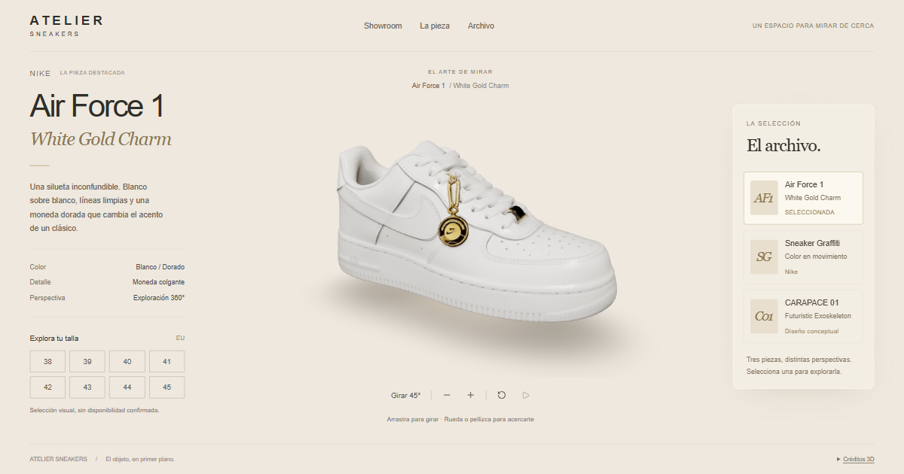

# ATELIER SNEAKERS

Showroom 3D interactivo de zapatillas con una dirección visual editorial: fondo beige, iluminación de estudio y espacio para explorar cada pieza. Proyecto de portafolio inspirado en Sneaker Archive, desarrollado con React y Three.js.



La captura muestra el modelo de [Riaan Fitzgerald](https://skfb.ly/pNW7X), bajo [CC BY 4.0](https://creativecommons.org/licenses/by/4.0/), adaptado según [LICENSES.md](LICENSES.md). Es una captura real del showroom, sin imágenes generadas.

## Experiencia

- Catálogo de Air Force 1 White Gold Charm, Sneaker Graffiti y CARAPACE 01.
- Exploración 360°, zoom, controles de teclado y gestos táctiles.
- Transiciones GSAP, flotación sutil y respeto por `prefers-reduced-motion`.
- Selección responsive: en móvil, elegir una pieza devuelve el visor a pantalla.
- Estados de carga, cancelación de selecciones anteriores y recuperación de errores.
- Visor separado del JavaScript inicial; descarga del modelo seleccionado y liberación de recursos salientes.
- Render pausado fuera de pantalla o con la pestaña oculta.
- Créditos 3D accesibles desde el pie.

Las tallas son una demostración visual; no hay compras, precios, backend ni pagos. Showroom independiente, no afiliado a Nike. Los modelos pertenecen a sus respectivos autores.

## Tecnologías

React 19, TypeScript y Vite 8; Three.js, React Three Fiber y Drei para el visor; GSAP para transiciones; Tailwind CSS 4 y CSS para la presentación. ESLint comprueba el código y Playwright permite ejecutar las pruebas de navegador existentes. Las versiones resueltas están en `package-lock.json`.

## Instalación y ejecución local

Requisitos: Node.js 24.x, npm y navegador con WebGL y aceleración gráfica. Entorno validado: Node.js 24.19.0. No se necesitan Blender, una cuenta de Sketchfab ni variables de entorno para ejecutar el showroom.

Desde la carpeta del repositorio clonado o descargado:

```sh
npm ci
npm run dev
```

Abrir la URL indicada por Vite, normalmente `http://localhost:5173`. Los tres GLB activos están versionados en `public/models/`; no es necesario descargarlos por separado. `npm ci` se indica para instalaciones nuevas, no para reinstalar una copia ya preparada.

| Comando | Uso |
| --- | --- |
| `npm run dev` | Servidor de desarrollo |
| `npm run build` | Validación TypeScript y compilación estática en `dist/` |
| `npm run preview` | Vista previa de `dist/`, normalmente en el puerto 4173 |
| `npm run lint` | ESLint |

Para revisar la entrega:

```sh
npm run build
npm run lint
npm run preview
```

Las pruebas de `tests/` se ejecutan con Node y requieren los servidores indicados en cada archivo. Utilizan Edge mediante Playwright. Las comparaciones históricas de optimización necesitan archivos de trabajo excluidos de Git; no todas esas pruebas son reproducibles con un clon limpio. Build, lint y el showroom sí usan los recursos versionados.

## Estructura principal

```text
src/
  scene/                  Visor, modelo, iluminación, controles y carga
  components/layout/      Cabecera y créditos
  components/product/     Ficha, catálogo y tallas de demostración
  animations/             Entrada editorial y transiciones
  data/                   Catálogo y atribuciones
  hooks/                  Visibilidad y movimiento reducido
  types/                  Tipos del producto
public/
  models/                 Tres GLB optimizados activos
  images/                 Captura real para presentación social
tests/                    Comprobaciones de navegador
.agents/skills/           Pautas locales del proyecto
LICENSES.md               Autores, licencias, fuentes y modificaciones
AVANCE.md                 Historial y estado de implementación
```

`assets-source/`, `blender/work/` y `blender/exports/` conservan originales y versiones de trabajo localmente y están excluidos de Git. También se excluyen archivos Blender, respaldos, `node_modules/`, `dist/`, temporales y cachés. No editar los originales para preparar una entrega.

## Modelos y atribución

| Pieza | Autor | Obra | GLB activo |
| --- | --- | --- | --- |
| Air Force 1 White Gold Charm | Riaan Fitzgerald | [Sketchfab](https://skfb.ly/pNW7X) | `atelier_af1_gold_hero_lossless_v002.glb` |
| Sneaker Graffiti | McLogics | [Sketchfab](https://sketchfab.com/3d-models/sneaker-727370d6df3e47bfabc30ac1b10fb445) | `atelier_sneaker_graffiti_lossless_v002.glb` |
| CARAPACE 01 | Atahan DANACI, perfil «6» | [Sketchfab](https://skfb.ly/pP7Gp) | `atelier_carapace_01_lossless_v002.glb` |

Los tres modelos tienen licencia [CC BY 4.0](https://creativecommons.org/licenses/by/4.0/), ya verificada mediante la API oficial de Sketchfab. Al compartirlos o adaptar el proyecto, conservar autor, enlace a la obra, licencia e indicación de cambios y los avisos aplicables de [LICENSES.md](LICENSES.md). No presentar los modelos como creación propia. La atribución también aparece en «Créditos 3D».

Adaptaciones: escala, orientación y centrado; emisión de Air Force 1 reducida de 1 a 0; compresión Meshopt y conversión selectiva de texturas a WebP sin pérdida. Se conservaron geometría, UV y resoluciones. Las licencias de modelos se documentan por separado de las dependencias y del código del showroom.

## Preparación para Vercel

La aplicación produce archivos estáticos y no necesita funciones de servidor. Configuración prevista:

| Ajuste | Valor |
| --- | --- |
| Framework Preset | Vite |
| Root Directory | Raíz del repositorio |
| Install Command | `npm ci` |
| Build Command | `npm run build` |
| Output Directory | `dist` |
| Node.js | 24.x, como el entorno local validado |

La navegación usa anclas de la misma página; no necesita reescrituras para rutas de aplicación. Los GLB y la captura se copian desde `public/` a la entrega. No se requiere un `vercel.json` para esta configuración. Referencia: [Vite en Vercel](https://vercel.com/docs/frameworks/frontend/vite).

La compilación y la vista previa estática están comprobadas localmente. Todavía no hay despliegue público ni dominio asignado; no se incluyen enlaces de demostración ficticios.

## Metadatos y vista previa social

`index.html` describe el showroom completo e incluye título, descripción, Open Graph y Twitter Card. El favicon activo es la «A» beige en SVG incrustada en el HTML; los SVG heredados de `public/` no son el favicon utilizado.

`public/images/atelier-sneakers-social.png` es una captura real de **1200 × 630 px**, tomada de la interfaz a 1600 × 840 píxeles CSS y escala 0,75, sin cambiar diseño ni modelos. Puede usarse como imagen de presentación del repositorio conservando la atribución.

**Pendiente cuando exista el dominio público:** añadir a `index.html` el enlace canónico y `og:url`, y conectar `og:image` y `twitter:image` con la URL HTTPS absoluta de `/images/atelier-sneakers-social.png`. Añadir `og:image:width=1200`, `og:image:height=630`, `og:image:type=image/png` y textos alternativos. Se omiten esas URL para no publicar direcciones inventadas o `localhost`; la tarjeta con imagen aún requiere ese paso. Verificar después el acceso público al PNG y la previsualización social.

## Estado y límites conocidos

Build y ESLint validados. El chunk 3D mantiene el aviso de tamaño de Vite; el JavaScript inicial está separado y los modelos se cargan bajo demanda. CARAPACE conserva unos 31,2 MB, por lo que su descarga depende de la conexión. Quedan las pruebas en dispositivos físicos y la publicación real. Historial en [AVANCE.md](AVANCE.md).
